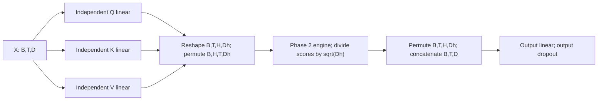

# Explicit multi-head self-attention

`src/zaid_lm/multihead_attention.py` implements learned projections around the
unchanged Phase 2 `scaled_dot_product_attention` function. No pretrained weights,
fused attention operation or high-level attention module is used. Standard
`nn.Linear` initialization supplies independent trainable matrices.

## Mathematics and API

The standard expression is

```text
MultiHead(Q,K,V) = Concat(head_1, ..., head_h) W_O
head_i = Attention(Q W_Q^(i), K W_K^(i), V W_V^(i))
Attention(q,k,v) = softmax(q k^T / sqrt(d_head) + mask) v
```

In self-attention all three initial representations are X. Three full-width linear
layers are equivalent to concatenating each head's projection columns. PyTorch
stores each weight as `(out_features, in_features)` and computes `X W^T + b`;
the mathematical row-vector expression above uses the transposed convention.
Different trainable Q/K/V slices give each head its own projection of the same
tokens. These untrained heads have no demonstrated linguistic specialization.

```python
MultiHeadSelfAttention(d_model, n_heads, dropout=0.0, bias=True,
                       *, device=None, dtype=None)
forward(x, *, causal=True, mask=None, return_attention=False)
```

Normally the result is Y `(B,T,D)`. Inspection explicitly returns `(Y,A)`, with A
`(B,H,T,T)`. Equal key and value widths are D/H. Positive integer D/H dimensions
exclude booleans; D must divide by H. Input must be a finite, nonempty rank-three
float32/float64 tensor of width D, matching the module's dtype/device. Noncontiguous
input is supported. There is no implicit cast, fallback or sequence truncation.
Use constructor `dtype=torch.float64` or standard `.double()` when appropriate.

## Head order and the actual baseline

For D=128, H=4, Dh=32, B=2, T=8:

| Stage | Shape | Meaning |
| --- | --- | --- |
| Input; each Q/K/V projection | `(2,8,128)` | Token features remain adjacent |
| Reshape each projection | `(2,8,4,32)` | Feature slice h*32:(h+1)*32 belongs to head h |
| Permute (0,2,1,3) | `(2,4,8,32)` | Batch and head become engine leading axes |
| Scores and weights | `(2,4,8,8)` | Each head uses its own 32-wide keys |
| Head outputs | `(2,4,8,32)` | Each token receives 32 value features per head |
| Permute (0,2,1,3), contiguous reshape | `(2,8,128)` | Concatenate heads in their original feature order |
| Learned output projection | `(2,8,128)` | Mix the concatenated head features per token |

Directly reshaping `(B,T,D)` into `(B,H,T,Dh)` would interchange token/head order.
The sentinel-feature test checks every `(batch,head,token)` slice, and merge recovers
the original tensor exactly. The asymmetric independent reference also rejects that
mistake. Merge uses a contiguous copy after permutation before reshaping.



## Masks, dropout and parameter count

Causal attention is the default: key j is forbidden for query i when j>i. Additional
masks are passed unchanged to Phase 2 and combined with that restriction. Boolean
True forbids; floating masks of the same dtype contain 0 or -inf. Masks broadcast
to `(B,H,T,T)`. Shared masks can be `(T,T)`; batch masks must be `(B,1,T,T)`;
head masks can be `(1,H,T,T)` or `(H,T,T)`. A `(B,T,T)` mask is not a general
batch-mask contract: broadcasting aligns its first axis with H. All-blocked rows
are rejected by the existing engine. Returned weights are normalized, with future
entries exactly zero in every head. Prefix perturbation tests check the final
projected output, including when positions have been added, not just weights.

Dropout in [0,1) follows the output projection. Training drops output coordinates
and scales retained values by 1/(1-p). Evaluation disables dropout. Probabilities
remain the engine's normalized pre-dropout probabilities in either mode. All
mathematical evidence uses eval and zero dropout. Phase 4 can supply the existing
configuration's 0.1 probability; no future residual/FFN dropout is implemented here.

With biases, each linear has D²+D parameters and all four give
`4*(D²+D)=66,048`. Without bias the count is `4*D²=65,536`. The executed baseline
checks the first formula against `sum(p.numel() for p in module.parameters())`.
This is the attention module's count; a complete GPT count awaits Phase 4.

## Independent verification and evidence

Run `python -m experiments.multihead_shape_trace` from the installed repository.
F03 captures real projection tensors using forward hooks and the actual input to
the output layer using a pre-hook. It inspects split/permuted tensors, re-executes
the unchanged engine on those captured projections and asserts equality with the
real forward weights and merged input. Scores are separately computed for inspection;
the production engine still returns only outputs and probabilities.

The small float64 example uses B=1,T=3,D=4,H=2, asymmetrical token rows and four
different fixed matrices (defined visibly in `small_example`). Biases also differ.
The oracle copies those weights read-only and uses Python loops for all linear
projections, explicit feature slicing, the pre-existing scalar attention reference,
head concatenation and final projection. It never calls the multi-head forward,
tensor matmul, splitting/merging helpers or production attention engine. Both
causal and unrestricted outputs/weights must agree with rtol=atol=1e-12.
The actual error and output numbers are in `report/evidence/F03_multihead_shape_trace.txt`.
Other tests cover multiple heads, batches, bias options, float32/64, gradcheck,
all four projection gradients, output projection isolation, mask failures and dropout.

No language model is trained. Input-value/score/output finite checks inherited from
Phase 2 add execution overhead and would synchronize accelerator execution; these
correctness-first checks have not been profiled or optimized. Validation uses CPU.
The module is self-attention only, with no cross-attention or KV cache. Integration
with residuals, FFN, LayerNorm, token embedding and LM logits remains Phase 4 work.

Equation source: [Vaswani et al., §3.2.2](https://arxiv.org/html/1706.03762v7).
Code, oracle, trace and tests are original project work, using basic PyTorch layers.
