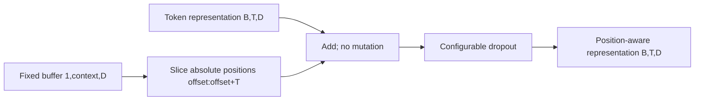

# Sinusoidal position representations

`src/zaid_lm/positional_encoding.py` adds fixed position vectors to token inputs.
The exact required equations are

```text
PE(pos, 2i)   = sin(pos / 10000^(2i/d_model))
PE(pos, 2i+1) = cos(pos / 10000^(2i/d_model))
```

pos is the absolute token index, i indexes frequency pairs, even dimensions use
sine, and odd dimensions use cosine at the same frequency. Position zero therefore
has [0,1,0,1,...]. For example at width 4, position one is approximately
`[0.8414709848, 0.5403023059, 0.0099998333, 0.9999500004]`.
Higher feature indices have larger denominators and change more slowly. Odd widths
retain the last sine feature; no accidental cosine broadcast occurs. Width one
is valid. The vectors depend on position rather than token identity or head count.
No positional parameter is learned.

## API, shapes and numerical policy

```python
SinusoidalPositionalEncoding(d_model, context_length, dropout=0.0,
                             *, device=None, dtype=torch.float32)
forward(x, *, offset=0)
```

The module returns `dropout(x + encoding[:, offset:offset+T])`. Input is nonempty
`(B,T,D)`, the selected position slice is `(1,T,D)` and output preserves `(B,T,D)`.
Addition broadcasts over batches and never mutates x. Dimensions are positive
integers excluding booleans. Offset is a nonnegative integer excluding booleans;
offset+T must fit context_length. No cache, automatic context growth or truncation
is present. Baseline D=128, context=128 and position_encoding="sinusoidal" remain
the existing ProjectConfig proposal; tokenizer and unresolved vocabulary are unchanged.



The table is computed using explicit double-precision powers, sin and cos, then
stored in the requested float32/float64 dtype. Input must match the buffer's dtype
and device and be finite. There is no implicit cast/device fallback. The persistent
registered `encoding` buffer appears in state_dict, migrates with `.to()`, and
requires no gradients. `.double()` casts existing stored float32 values; to create
full double precision directly, use constructor dtype=torch.float64. Casting cannot
recover digits already rounded to float32. Tests verify checkpoint roundtrip and
CPU dtype migration; meta-device checks exercise mismatch errors without GPU work.

Dropout is optional and follows addition, with the usual retained-coordinate scaling
in training; eval disables it. Default zero allows deterministic direct composition.
Future Phase 4 can use config.dropout=0.1. F04 uses eval/zero dropout. Adding positions
has identity input gradient in the absence of dropout and no trainable position weights.

## What F04 proves

`python -m experiments.visualize_positions` obtains the baseline table by passing
zero representations through the implemented module. Every one of its 16,384
values is checked against independent Python math.sin/math.cos and powers. Float32
absolute tolerance is 1e-6; constructor float64 tolerance is 1e-12. Position zero,
finiteness, bounds and zero parameter count are also checked. Actual errors and
range are in `report/evidence/F04_positional_encoding.json`.

The left panel plots absolute position against embedding dimension with a fixed
[-1,1] color scale. The right panel plots sine dimensions 0,2,16,64 to contrast fast
and slow variation. Neighboring sine/cosine columns share frequencies, and their
paired squared values sum to one within rounding. These are fixed mathematical
features, not learned linguistic behavior or trained-model attention.

Self-attention with shared per-token projections, no positional inputs, unrestricted
visibility and deterministic dropout-free evaluation is permutation-equivariant:
permuting tokens permutes output tokens, while attention weights permute both token
axes. Masks must also be permuted when present. A fixed causal mask already supplies
an ordering restriction and does not satisfy arbitrary permutation symmetry.
Adding absolute position vectors assigned to token slots breaks the unrestricted
symmetry when token content is reordered but slot indices remain fixed. Reordering
both representations and their attached position vectors would still be a permutation
of the combined input. Tests demonstrate the first distinction with actual module
outputs. Position information allows order to affect outputs; it does not establish
learned use of that information before training.

The only demonstration composition here is positions -> multi-head attention.
Future residual, FFN, LayerNorm, complete GPT and MLM/CLM work require Phase 4 approval.
Larger-context extrapolation and accelerator performance have not been qualified.

Equation source: [Vaswani et al., §3.5](https://arxiv.org/html/1706.03762v7).
Buffer contract: [PyTorch 2.10 Module.register_buffer](https://docs.pytorch.org/docs/2.10/generated/torch.nn.Module.html#torch.nn.Module.register_buffer).
Implementation, independent scalar checks and F04 plotting code are original work.
